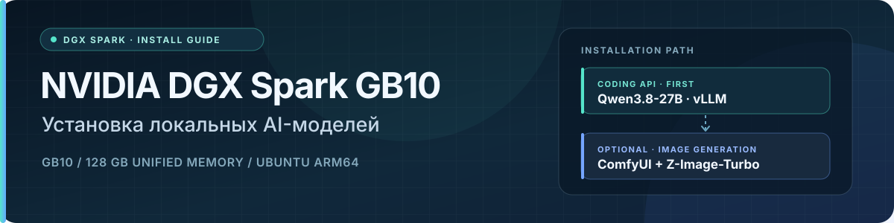

<!-- markdownlint-disable MD041 -->


 

# DGX Spark 128 ГБ: установка локальных AI-моделей

Руководство описывает последовательное развёртывание Qwen3.8-27B (mixed NVFP4/FP8) как vLLM inference API и дополнительного контура генерации изображений ComfyUI + Z-Image-Turbo на NVIDIA DGX Spark GB10 с 128 ГБ unified memory и Ubuntu 24.04.5 LTS ARM64; команды и параметры runtime рассчитаны исключительно на этот аппаратно-программный профиль.

## Порядок установки

1. Подготовьте Spark и проверьте архитектуру, память, диск и доступ к Docker.
2. Установите Qwen3.8-27B как локальный coding API.
3. Проверьте API через SSH-туннель с рабочего компьютера.
4. При необходимости отдельно установите ComfyUI и Z-Image-Turbo для генерации изображений.

Сначала устанавливайте и проверяйте один сценарий. Перед запуском ComfyUI остановите vLLM: обе модели используют общую память Spark.

## Что устанавливается

### 1. Qwen3.8-27B: coding API

- **Целевая модель:** [`nvidia/Qwen3.8-27B-NVFP4`](https://huggingface.co/nvidia/Qwen3.8-27B-NVFP4), mixed NVFP4/FP8; лицензия checkpoint — Apache-2.0.[1][2]
- **Draft-модель:** [`z-lab/Qwen3.8-27B-DFlash2`](https://huggingface.co/z-lab/Qwen3.8-27B-DFlash2), необходимая выбранному DFlash2-рецепту; лицензия — Apache-2.0.[3][4]
- **Runtime:** NVIDIA vLLM image `26.10.pre1-py3`, закреплённый digest и NVIDIA launcher для Spark 128 ГБ.[5][6]
- **Установка и запуск:** [Qwen3.8-27B runbook](./model/Qwen3.8-27B/README.md). В нём приведены точные revisions моделей, команды `hf download`, подготовка `/srv/ai`, запуск API, SSH-туннель и smoke test.

Начинайте с этого runbook, если вам нужен локальный API для кода и чата. Не заменяйте image, checkpoint, revision или параметры запуска командами из другого рецепта.

### 2. ComfyUI + Z-Image-Turbo: генерация изображений

- **Приложение:** ComfyUI `v0.33.2` по NVIDIA setup recipe.[7]
- **Модели:** BF16 baseline из [`Comfy-Org/z_image_turbo`](https://huggingface.co/Comfy-Org/z_image_turbo): `z_image_turbo_bf16.safetensors`, `qwen_3_4b.safetensors` и `ae.safetensors`. Для этого набора в Hub указана лицензия Apache-2.0.[8][9]
- **Установка и проверка:** [ComfyUI + Z-Image-Turbo runbook](./docs/comfyui-zimage.md). Там указаны pinned snapshot, контрольные суммы файлов, setup-команды и workflow для smoke test.

Это отдельный, необязательный этап. Следуйте именно BF16-рецепту из runbook; не подменяйте отдельные файлы на INT8 или NVFP4 варианты. NVIDIA setup размещает модели внутри каталога ComfyUI, а не в `/srv/ai/models/comfyui` автоматически.

## Перед установкой

Выполните на самом Spark. `uname -m` должен показать `aarch64`; проверьте, что `MemTotal` соответствует конфигурации 128 ГБ и на целевом диске достаточно места.

```bash
uname -m
cat /etc/os-release
grep -E 'MemTotal|MemAvailable' /proc/meminfo
free -h
df -h /srv "$HOME"
sudo docker info --format '{{.ServerVersion}}'
```

Если объём памяти, ОС или архитектура не соответствуют целевому профилю, остановитесь и не применяйте эти рецепты. `nvidia-smi` может не показывать размер общей памяти Spark; сверяйте профиль по `MemTotal` и `free -h`.

Если Docker доступен только через `sudo`, используйте команды с `sudo`, как указано в Qwen runbook. Не добавляйте пользователя в группу `docker` без отдельного решения: такой доступ фактически даёт привилегии root.

## Установка и приёмка

### Шаг 1. Подготовить хранилище

Откройте [план моделей и хранения](./docs/model-install-plan.md), проверьте свободное место, существующие каталоги и переменные кэша. Не удаляйте и не перемещайте существующие данные автоматически.

### Шаг 2. Установить Qwen и проверить API

Выполните шаги Qwen runbook по порядку. В нём закреплены NVIDIA image digest, revisions основного и draft checkpoint, команды загрузки, loopback-привязка API и подключение через SSH-туннель. После старта проверьте `/health`, `/v1/models` и отправьте короткий запрос с рабочего компьютера.

### Шаг 3. По желанию установить генерацию изображений

Остановите Qwen/vLLM и выполните ComfyUI runbook. Он использует pinned setup script и три BF16-файла. Затем импортируйте указанный pinned workflow, запустите короткую генерацию и проверьте, что изображение сохранено в output-каталог.

## Что считать проверкой

- **Сверка с источником** подтверждает, что в инструкции указаны конкретные модели, версии, рецепт и лицензии.
- **Статическая проверка** (например, `bash -n`) проверяет синтаксис скрипта, но не устанавливает модель.
- **Проверка на Spark** требует реальной загрузки файлов и запуска: для Qwen — готовый API и успешный запрос; для ComfyUI — завершённый workflow и сохранённый результат.

Не считайте ссылку на рецепт, доступность Docker или успешный `bash -n` доказательством работы модели. Критерии приёмки и отдельный статус фактических тестов находятся в [матрице проверки](./docs/validation-status.md).

## Безопасность

- Оставляйте API на `127.0.0.1`; подключайтесь по SSH-туннелю. Не публикуйте неаутентифицированный API или ComfyUI в локальной сети и интернете.
- Не сохраняйте токены Hugging Face/NGC в командах, документации, Git или логах.
- Проверяйте свободное место и точные пути до скачивания. Не запускайте несколько крупных моделей одновременно.

## Документы

- [Qwen3.8-27B: установка и API](./model/Qwen3.8-27B/README.md)
- [ComfyUI + Z-Image-Turbo: установка и генерация](./docs/comfyui-zimage.md)
- [План моделей и хранения](./docs/model-install-plan.md)
- [Матрица моделей, версий и лицензий](./docs/model-and-license-matrix.md)
- [Матрица проверки и критерии приёмки](./docs/validation-status.md)

## Sources

[1] https://huggingface.co/nvidia/Qwen3.8-27B-NVFP4

[2] https://huggingface.co/nvidia/Qwen3.8-27B-NVFP4/blob/main/LICENSE

[3] https://huggingface.co/z-lab/Qwen3.8-27B-DFlash2

[4] https://huggingface.co/api/models/z-lab/Qwen3.8-27B-DFlash2

[5] https://build.nvidia.com/spark/vllm/intermediate

[6] https://raw.githubusercontent.com/NVIDIA/dgx-spark-playbooks/30883150541743d580c9c347700c6ac99fc396d2/nvidia/playbook-vllm/assets/sync-vllm-spark-128gb-qwen38-27b.sh

[7] https://raw.githubusercontent.com/NVIDIA/dgx-spark-playbooks/30883150541743d580c9c347700c6ac99fc396d2/nvidia/playbook-comfyui/assets/setup.sh

[8] https://huggingface.co/Comfy-Org/z_image_turbo

[9] https://huggingface.co/api/models/Comfy-Org/z_image_turbo
